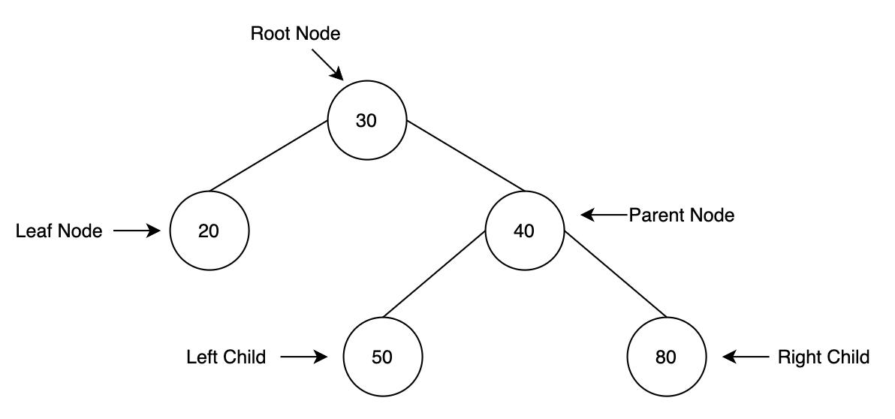
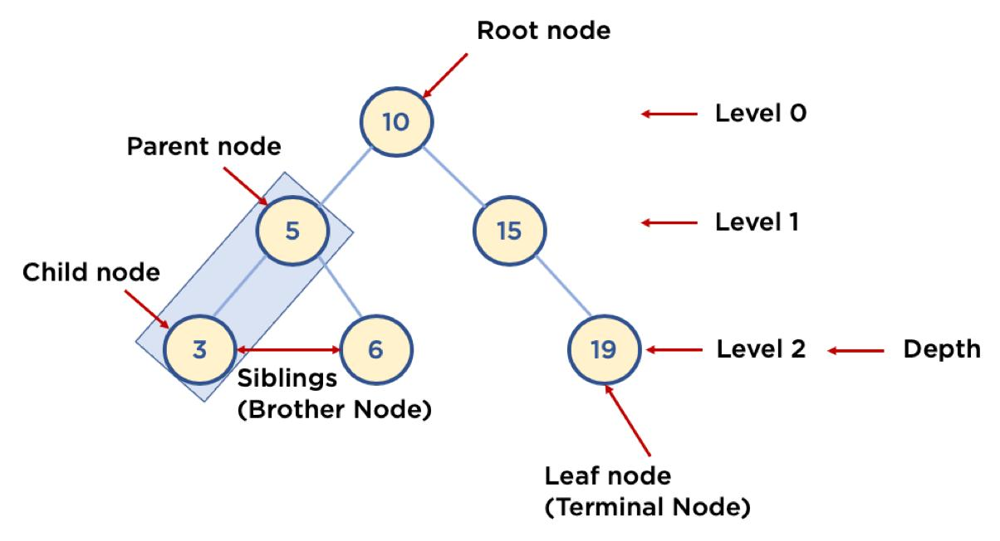

## Our learning sequence:
    
1. Binary Tree fundamentals
2. Tree terminology and properties
3. Tree representation in Java
4. Recursive tree traversal
5. Inorder, Preorder and Postorder
6. Level Order Traversal
7. Height and Depth of a Tree
8. Maximum Depth of Binary Tree
9. Diameter of Binary Tree
10. Practice problems


## Lesson 1 — What is a Binary Tree?
### A Tree is a non-linear data structure that stores data in hierarchical form.

Unlike arrays and linked lists, data is not stored sequentially.

Think of an organization:



A Binary Tree is a tree in which each node can have at most two children:
- Left child
- Right child


For example:
```
          10
         /  \
        20   30
       / \     \
      40  50    60
```
Here:
- 10 is the Root.
- 20 and 30 are children of 10.
- 40 and 50 are children of 20.
- 60 is the right child of 30.

## Lesson 2 — Important Terminology
#### Understand these terms carefully because they appear frequently in interviews.


```
Term	Meaning
Root	Topmost node (10)
Parent	Node having children
Child	Node connected below a parent
Leaf	Node with no children (40, 50, 60)
Sibling	Nodes sharing the same parent (20, 30)
Edge	Connection between two nodes
Depth	Number of edges from root to a node
Height	Longest downward path to a leaf
```
Important: A binary tree node can have 0, 1, or 2 children. It doesn't have to have exactly two.